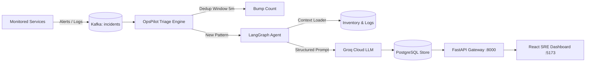

# OpsPilot 🛸
### Autonomous Agentic SRE & DevOps Incident Remediation Platform

OpsPilot is an agentic DevOps tool that monitors real-time telemetry, deduplicates cascading errors, queries Large Language Models (LLMs) with infrastructure context, synthesizes root causes, and suggests or executes whitelisted remediation commands.

---

## 🏗️ Architecture Overview

OpsPilot runs completely decoupled from monitored microservices to eliminate circular failure risks.



### Core Subsystems

1. **Kafka Event Ingestion**: Real-time asynchronous streaming via Apache Kafka 4.0 (KRaft mode).
2. **Triage & Deduplication Engine**: 5-minute sliding window deduplication. 500 identical errors become 1 incident with occurrence counter incremented (`occurrences += 1`), preventing LLM alert storms.
3. **Context Augmentation**: Integrates `infra_inventory.yaml` and `application.log` so the LLM knows the actual runtime (Podman/Docker/Kubernetes) and container names.
4. **LangGraph Reasoning Engine**: Structured JSON diagnosis (`problem`, `root_cause`, `evidence`, `severity`, `suggested_fix`, `commands`).
5. **Execution Layer**: Whitelisted commands only (`podman restart`, `docker restart`, cache clears) with full audit logging.
6. **Dark-Mode SRE Dashboard**: High-density Grafana/Datadog-inspired React operations console.

---

## 📂 Repository Structure

```
OpsPilot/
├── backend/                  # FastAPI & LangGraph backend service
│   ├── app/
│   │   ├── agent/            # LangGraph state machine & routing
│   │   ├── api/              # FastAPI router (/api/chat, /incidents)
│   │   ├── config/           # Pydantic BaseSettings
│   │   ├── db/               # SQLAlchemy models & session
│   │   ├── inventory/        # infra_inventory.yaml & loader
│   │   ├── kafka/            # AIOKafka consumer & producer
│   │   ├── llm/              # Groq client wrapper (LLaMA 3.3 70B)
│   │   ├── logs/             # application.log telemetry sample
│   │   ├── services/         # Incident repository & agents
│   │   └── tools/            # Log reading tools
│   ├── tests/                # Pytest test suite (24 passing unit/integration tests)
│   ├── Dockerfile            # Backend container definition
│   └── pyproject.toml        # Dependencies managed via uv
├── frontend/                 # Vite + React 18 + TypeScript SRE dashboard
│   ├── src/
│   │   ├── App.tsx           # Incident feed, execution logs, & chat drawer
│   │   ├── types.ts          # TypeScript domain models
│   │   └── index.css         # Dark-mode design system
│   ├── package.json
│   └── vite.config.ts        # Reverse proxy to backend
├── docker/                   # Deployment assets
│   ├── Dockerfile.backend
│   └── Dockerfile.frontend
├── docs/                     # Detailed architectural & API specs
│   ├── architecture.md       # Deep dive system design & flows
│   └── api.md                # Complete REST & Kafka API reference
└── docker-compose.yml        # Orchestration (Backend + Frontend + Kafka + Postgres)
```

---

## ⚡ Quickstart: Run Everything with Docker Compose

To start the complete full-stack environment (Backend, Frontend, Kafka broker, and PostgreSQL database):

### 1. Configure Environment

Create `./backend/.env` from template:

```bash
cp backend/.env.example backend/.env
```

Add your [Groq Cloud API Key](https://console.groq.com/keys) in `backend/.env`:
```env
GROQ_API_KEY=gsk_your_actual_key_here
```

### 2. Start Services

```bash
docker compose up --build
```

### 3. Access Services

| Service | URL | Description |
|---|---|---|
| **Frontend Dashboard** | `http://localhost:5173` | React SRE console |
| **Backend API Docs** | `http://localhost:8000/docs` | FastAPI Swagger UI |
| **Kafka Broker** | `localhost:9092` | PLAINTEXT broker |
| **PostgreSQL** | `localhost:5432` | OpsPilot database |

---

## 🛠️ Local Development (Running Without Full Docker)

You can run the backend and frontend locally for development.

### 1. Run the Backend

```bash
cd backend

# 1. Install dependencies using uv
uv sync

# 2. Configure .env (PostgreSQL or local SQLite)
cp .env.example .env
# For zero-config local testing with SQLite, set in .env:
# DATABASE_URL=sqlite:///./opspilot.db

# 3. Start the FastAPI server
uv run uvicorn app.main:app --host 0.0.0.0 --port 8000 --reload
```

### 2. Run the Frontend

In a separate terminal:

```bash
cd frontend

# 1. Install dependencies
npm install

# 2. Start the Vite development server
npm run dev
```

Open `http://localhost:5173` in your browser. Vite proxies requests to `http://localhost:8000`.

---

## 🧪 Testing Everything

### Run Backend Unit & Integration Tests

The backend includes 24 automated tests covering database models, deduplication logic, LangGraph state routing, LLM JSON extraction, and FastAPI endpoints:

```bash
cd backend
uv run pytest -v
```

Output:
```
================== test session starts ==================
tests/test_agent_routing.py::test_route_question_keywords PASSED
tests/test_agent_routing.py::test_route_question_general PASSED
tests/test_agent_routing.py::test_graph_structure PASSED
tests/test_api_endpoints.py::test_home_endpoint PASSED
tests/test_api_endpoints.py::test_list_incidents_endpoint PASSED
tests/test_api_endpoints.py::test_chat_endpoint PASSED
tests/test_api_endpoints.py::test_test_event_endpoint PASSED
tests/test_config.py::test_settings_default_values PASSED
tests/test_config.py::test_settings_custom_values PASSED
tests/test_db_models.py::test_incident_model_instantiation PASSED
tests/test_incident_repository.py::test_save_incident PASSED
tests/test_incident_repository.py::test_find_open_incident_dedup_window PASSED
tests/test_incident_repository.py::test_find_open_incident_ignores_closed PASSED
tests/test_incident_repository.py::test_bump_occurrence PASSED
tests/test_incident_service.py::test_run_incident_agent_valid_json PASSED
tests/test_incident_service.py::test_run_incident_agent_markdown_wrapped_json PASSED
tests/test_incident_service.py::test_run_incident_agent_invalid_json_fallback PASSED
tests/test_inventory.py::test_load_inventory_existing_file PASSED
tests/test_inventory.py::test_format_inventory_with_data PASSED
tests/test_inventory.py::test_format_inventory_empty_containers PASSED
tests/test_kafka_consumer.py::test_handle_message_deduplication[asyncio] PASSED
tests/test_kafka_consumer.py::test_handle_message_new_incident[asyncio] PASSED
tests/test_log_tool.py::test_read_logs_file_exists PASSED
tests/test_log_tool.py::test_read_logs_file_missing PASSED
============= 24 passed in 0.20s =============
```

### Build & Validate Frontend

```bash
cd frontend
npm run build
```

---

## 📡 Live Telemetry & Simulation

Once the system is running:

1. **Simulate an Incident**:
   - Click the **"Trigger Incident Event"** button on the top-right of the dashboard, or run:
     ```bash
     curl -X POST http://localhost:8000/test-event
     ```
2. **View Deduplication**:
   - Trigger the event multiple times within 5 minutes.
   - Observe that only 1 incident row exists in the feed, with the occurrences badge incrementing (`2x`, `3x`, `4x`).
3. **Inspect AI Diagnosis**:
   - Click any incident card in the dashboard to inspect the problem summary, evidence list, and whitelisted remediation commands (`podman restart ...`).
   - Click **Run** or **Copy** on suggested remediation commands.
4. **Chat with the Agent**:
   - Open the **AI DevOps Agent** tab in the dashboard and ask questions like:
     - *"Why is payment-service timing out?"*
     - *"Analyze the recent logs for database connection pool errors."*

---

## 📚 Documentation Links

- [Complete Architecture Deep Dive](docs/architecture.md)
- [REST API & Kafka Schema Reference](docs/api.md)
- [Backend Development Guide](backend/README.md)
- [Frontend Development Guide](frontend/README.md)
