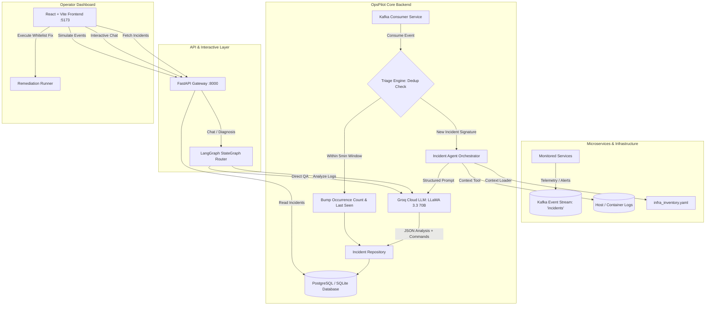
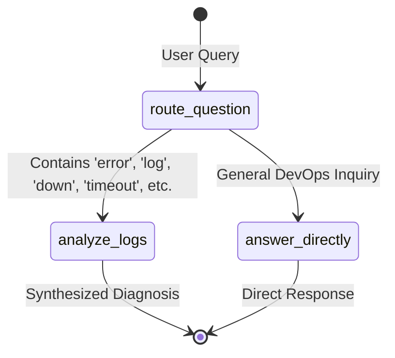

# OpsPilot Architecture Specification

## 1. System Overview

**OpsPilot** is an agentic DevOps and SRE platform designed to autonomously triage production telemetry, diagnose incidents using Large Language Models (LLMs), and propose or execute whitelisted remediation commands without circular dependency on monitored applications.



---

## 2. Core Subsystems

### 2.1 Ingestion & Message Broker (Kafka)
- **Broker**: Apache Kafka 4.0.1 in KRaft mode (no ZooKeeper dependency).
- **Default Topic**: `incidents` (configurable via `KAFKA_INCIDENTS_TOPIC`).
- **Consumer Group**: `opspilot-incidents` with auto-offset-reset to `earliest`.
- **Payload Schema**:
  ```json
  {
    "type": "CPU_HIGH",
    "service": "payment-service",
    "cpu": 94,
    "timestamp": "2026-10-25T14:15:00Z"
  }
  ```

### 2.2 Triage & Deduplication Engine
Raw error streams are noisy: 500 identical exceptions must not generate 500 LLM calls or 500 alerts.
- **Window**: 5-minute sliding window (`DEDUP_WINDOW = timedelta(minutes=5)`).
- **Matching Rule**: Matches open incidents where `Incident.service == service` and `Incident.type == type` and `Incident.status == 'open'`.
- **Action on Match**:
  - `Incident.occurrences += 1`
  - `Incident.last_seen = now()`
  - Bypasses LLM inference completely (cost savings and reduced noise).

### 2.3 Context Augmentation & Tools
Before calling the LLM, OpsPilot enriches the incident event with local context:
1. **Infrastructure Inventory** (`app/inventory/loader.py`):
   - Reads `infra_inventory.yaml` containing namespace, container names, runtime (`podman`, `docker`, or `kubectl`), and roles.
   - Constrains LLM commands to only target real, existing containers using the correct runtime syntax.
2. **Log Tool** (`app/tools/log_tool.py`):
   - Extracts tail application logs (`application.log`) or container logs.

### 2.4 Agent Orchestration & Structured Output
- **Model**: `llama-3.3-70b-versatile` via Groq Cloud (`ChatGroq`).
- **Structured Output**: Bound with `response_format={"type": "json_object"}`.
- **Output Schema**:
  ```json
  {
    "problem": "Brief description of the problem",
    "root_cause": "Underlying architectural or operational cause",
    "evidence": ["Log snippet 1", "Metric threshold 2"],
    "suggested_fix": "Recommended remediation approach",
    "commands": ["podman restart payment_service_1"],
    "severity": "critical | high | medium | low"
  }
  ```

### 2.5 LangGraph Interactive Routing
For interactive chat (`/api/chat`), OpsPilot uses a LangGraph `StateGraph`:



---

## 3. Database Schema

OpsPilot stores triaged incidents in the `incidents` table:

| Column | Type | Description |
|---|---|---|
| `id` | `INTEGER` (PK, Auto-increment) | Unique incident ID |
| `type` | `VARCHAR(64)` | Error classification (e.g., `CPU_HIGH`, `OOM`) |
| `service` | `VARCHAR(128)` | Microservice or container name |
| `severity` | `VARCHAR(16)` | `critical`, `high`, `medium`, `low` |
| `problem` | `TEXT` | LLM synthesized problem statement |
| `root_cause` | `TEXT` | Root cause analysis |
| `suggested_fix` | `TEXT` | Recommended remediation plan |
| `evidence` | `JSON` | List of supporting log snippets and metrics |
| `commands` | `JSON` | List of whitelisted remediation commands |
| `raw_event` | `JSON` | Original event payload from Kafka |
| `occurrences` | `INTEGER` | Dedup counter (default 1) |
| `status` | `VARCHAR(16)` | `open`, `investigating`, `mitigated`, `resolved` |
| `first_seen` | `TIMESTAMP WITH TIMEZONE` | Incident onset timestamp |
| `last_seen` | `TIMESTAMP WITH TIMEZONE` | Most recent occurrence timestamp |

---

## 4. Remediation Execution Policy

To prevent dangerous or destructive operations:
- **Whitelisted Commands Only**: Only non-destructive or recovery commands (e.g., container restart, logs inspection, cache flush).
- **Human-in-the-Loop Approval**: Operators can review and click "Run" in the dashboard, or configure automated execution for specific low-risk policies.
- **Audit Trail**: Every command execution records timestamp, target, command string, executor, and exit code.
